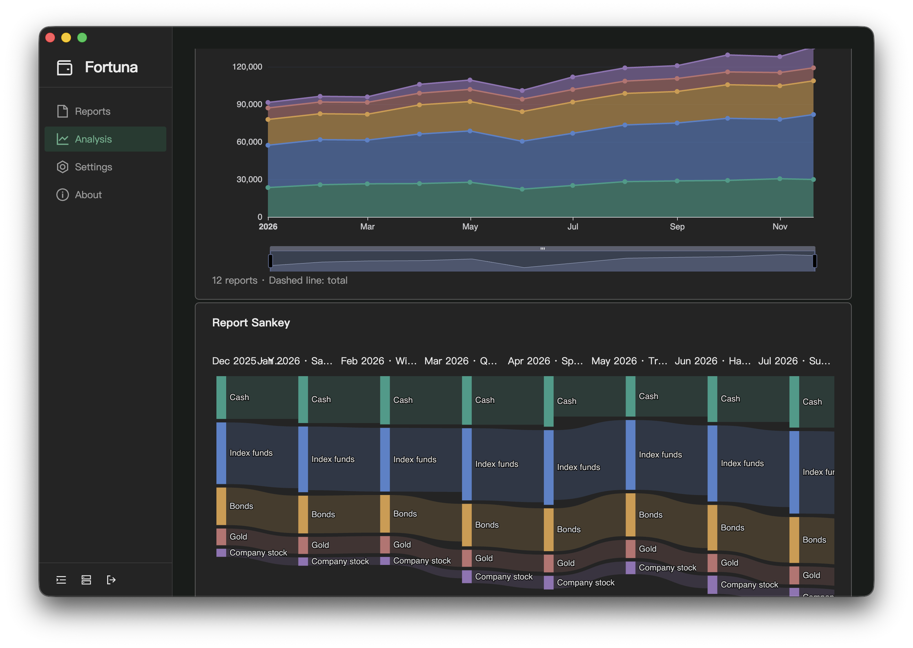
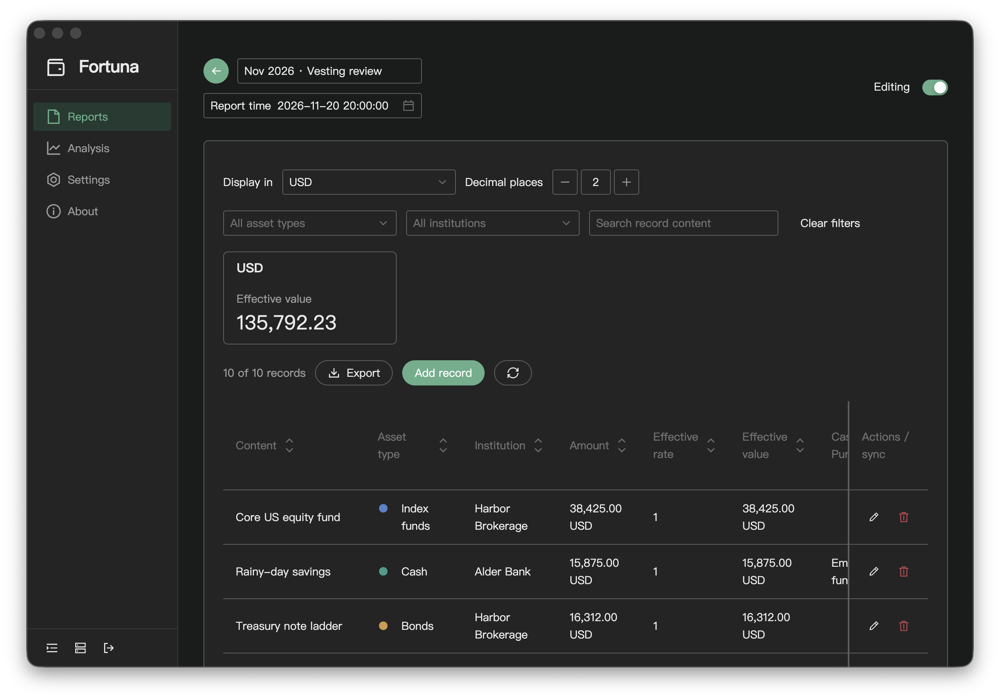
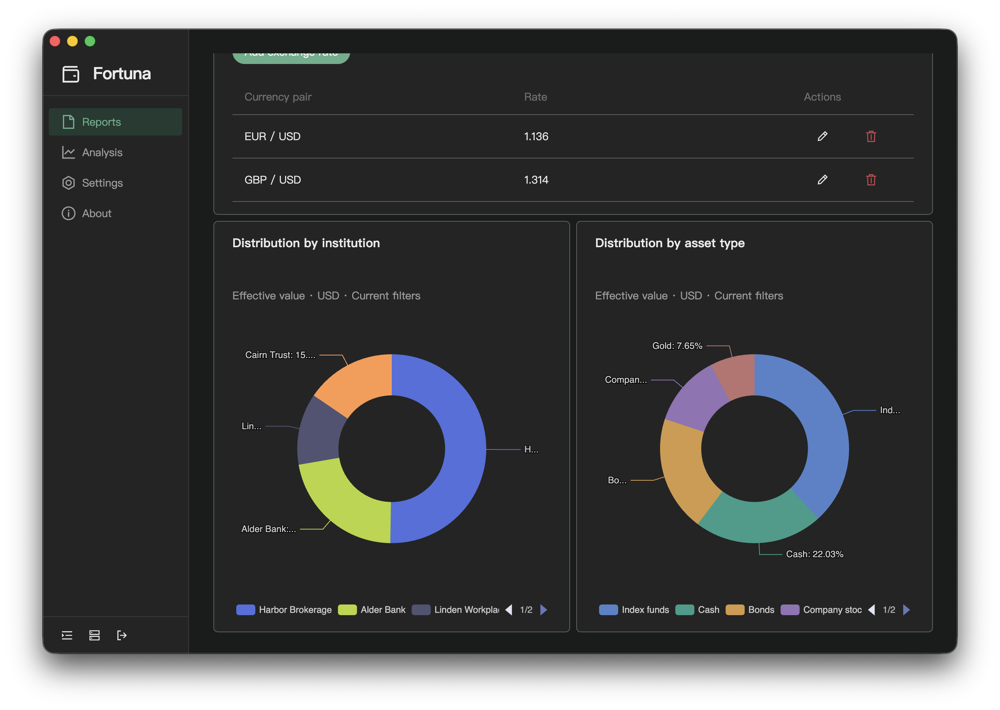
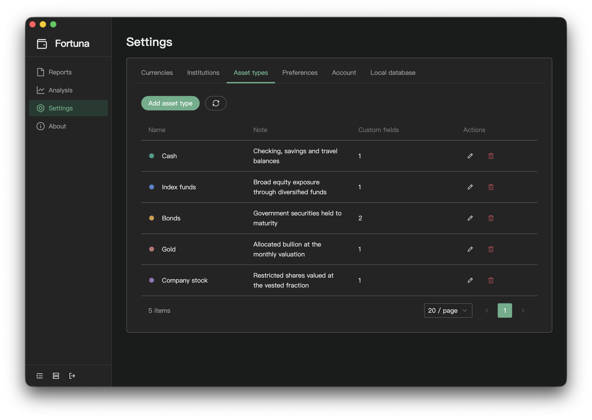
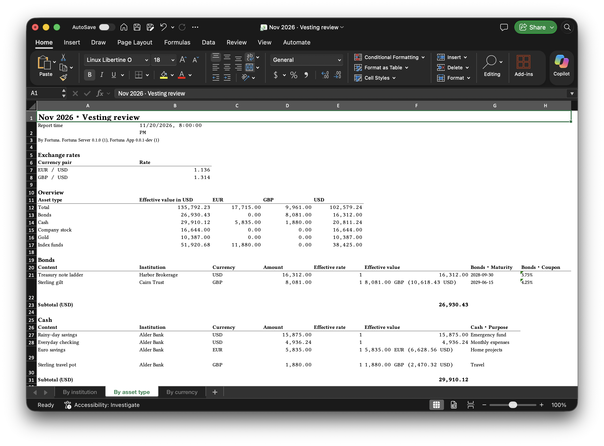
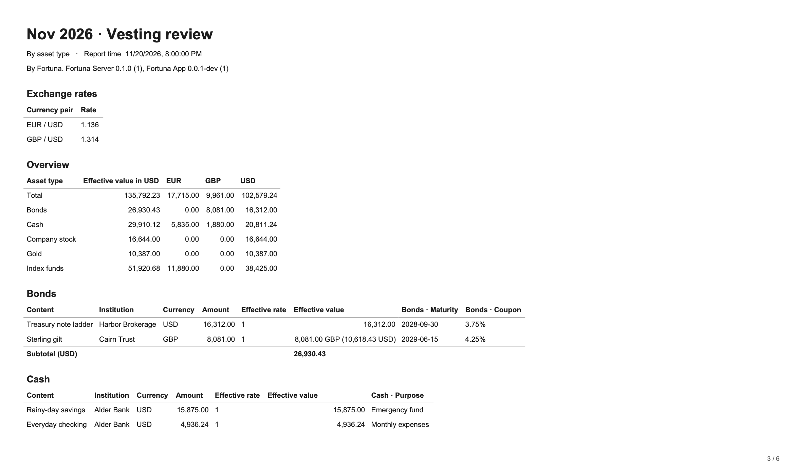

  

<h1 align="center">Fortuna Audit</h1>

Fortuna Audit helps you track your savings and investments across accounts and currencies. Each report captures what you own on a given date, so you can see how your holdings change over time.

## See how your money grows

## Export an audit report
Save an Excel workbook or a printable PDF.

